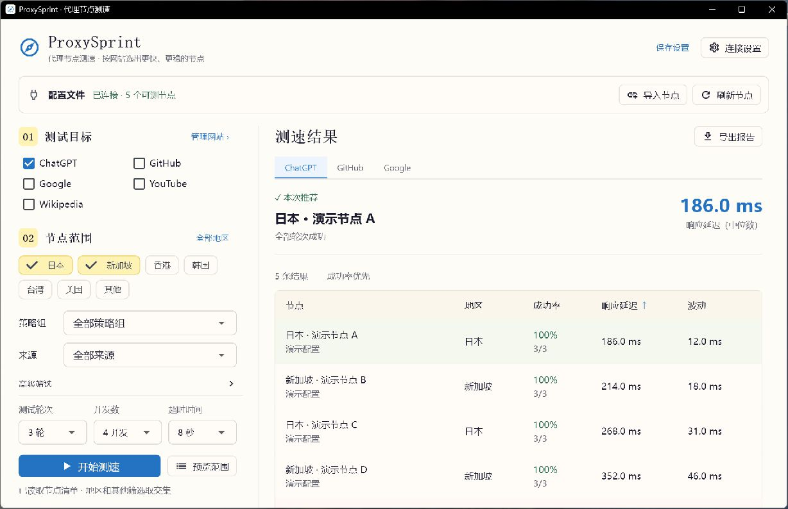

# ProxySprint · Proxy node testing

**Find faster, more reliable proxy nodes for the websites you use.**

Import a Clash/Mihomo subscription or configuration file, test your nodes with real HTTP requests, and compare success rate, response latency and variation for each website. Available for **Windows and macOS**.

[**Download**](https://github.com/yyyzl/ProxySprint/releases/latest) · [简体中文](README.md)

*The Chinese-language interface is shown with demonstration nodes and sample results.*

## What you can do

- Test ChatGPT, GitHub, Google, YouTube, Wikipedia or your own HTTP/HTTPS URLs.
- Import Clash/Mihomo YAML or JSON from a subscription URL or a local file. No separate proxy client required.
- Compare nodes by website, with recommendations limited to nodes that succeed in every test round.
- Filter by region, group, source or name; select individual nodes and export CSV/JSON reports.

## Download and start

| Platform | Package | Installation |
| --- | --- | --- |
| Windows 10/11 x64 | [EXE installer](https://github.com/yyyzl/ProxySprint/releases/latest/download/ProxySprint-Setup.exe) | Run the installer |
| macOS Apple Silicon | [ARM64 DMG](https://github.com/yyyzl/ProxySprint/releases/latest/download/ProxySprint-macOS-arm64.dmg) | Drag ProxySprint into Applications |
| macOS Intel | [x86_64 DMG](https://github.com/yyyzl/ProxySprint/releases/latest/download/ProxySprint-macOS-x86_64.dmg) | Drag ProxySprint into Applications |

A [portable Windows ZIP](https://github.com/yyyzl/ProxySprint/releases/latest/download/ProxySprint-Windows-x64.zip) is also available. Keep the extracted folder intact and open `ProxySprint.exe`. Python, Flutter and Node.js are not required.

Windows packages are currently unsigned; macOS builds are ad-hoc signed and not Apple-notarized. Checksums are included in each release.

1. Click **导入节点** (Import nodes) and paste your subscription URL or choose a configuration file.
2. Choose websites and nodes. Click **全部地区** (All regions) to remove the region filter.
3. Click **开始测速** (Start testing) and compare each website's results.

Existing Clash Verge Rev users can also read their client's configuration. Testing does not switch the client's active node.

## Understanding results

Prefer a **100% success rate**, then lower **response latency** (median time to first byte) and lower **variation** across rounds. These are website response tests, not bandwidth measurements, AI generation speed tests or service-unblocking checks.

Subscriptions are fetched directly. If a URL is unreachable, import a downloaded file. Base64 subscriptions and individual share links are not supported yet. Regions are inferred from node names. Bring your own nodes; none are provided.

Settings and reports stay on your device. Subscription URLs and node credentials are excluded from reports.

## Upgrading from NodeScope

ProxySprint is the new name of NodeScope. Windows users can install over their existing version. On macOS, copy ProxySprint into Applications and launch it; you can remove the old NodeScope app after checking the new version. Existing settings and reports remain available.

## Development and licensing

[Build and test](CONTRIBUTING.md) · [Architecture](DESIGN.md) · [Report an issue](https://github.com/yyyzl/ProxySprint/issues)

The interface is adapted from [esther-design-system](https://github.com/esthersjw/esther-design-system) by ESTHER不二 (esthersjw), under **CC BY-NC-SA 4.0**. See [third-party notices](THIRD_PARTY_NOTICES.md) for dependencies, bundled Mihomo licensing and source links.
